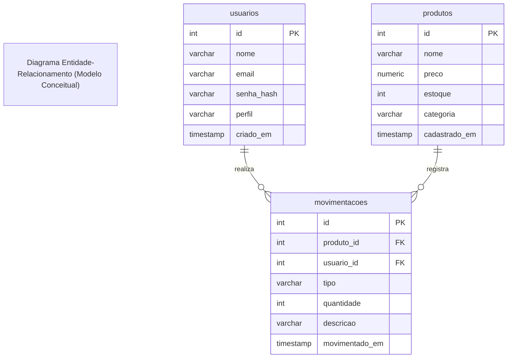

# SENAI Supply MVC - Especificações de Requisitos do Sistema ISO 29148

## 1. Identificação
- Projeto: Senai Supply MVC
- Versão: 1.0
- Responsável: Equipe de Desenvolvimento (I1D46B)

## 2. Objetivo

Desenvolver uma aplicação web didática em arquitetura MVC Artesenal com PHP 8.3+;
PostgreSQL, Composer (PSR-4), controle estrito de autenticação por sessão Interceptação de rotas por Guards/Middlewares, registro transacionais (ACID) de movimentação de estoque e gravação contínua de logs e auditoria corporativa

## 3. Escopo

### 3.1 Contextualização 

Na manufatura 4.0, sistemas legados com código espaguete geram gargalos de produção, falhas de segurança e inconsistências graves de estoque. Como desenvolvedor(a) back-end júnior na fábrica do SENAI, sua equipe foi convocada para refatorar e modernizar o SENAI Supply, substituindo scripts desorganizados por uma arquitetura corporativa Model-View-Controller (MVC) artesanal.
O sistema deve blindar o acesso por perfis de operadores, garantir a integridade atômica das movimentações físicas de insumos e manter uma trilha contínua de auditoria em arquivos de log protegidos.

### 3.2 Orientação do Desenvolvimento

- Autenticação com senhas criptografadas
- Controle de acesso baseado em papéis (RBAC) com Guards
- Elaboração das Regras de Negócio e Aplicação em Camadas MVC
- Padrão Front Controller e Autoload PSR-4
- Controle Transacional do Banco de Dados (ACID - Atomicidade, Consistência, Isolamento, Durabilidade)
- Serviço de Auditoria de Logs

## Requisitos do sistema

## 4.1 Requisitos Funcionais (RF)

- **RF-001**: Autenticação de Usuários: O sistema deve autenticar o usuário por e-mail e senha
- **RF-002**: Logout Seguro: O encerramento da sessão deve ocorrer exclusivamente via `POST/logout`
- **RF-003**: Guard de Autenticação: Rotas restritas devem direcionar usuário para login
- **RF-004**: Guard de Autorização por Pefil: restrição de rotas por perfil de usuário
- **RF-005**: Catalogo de produtos: `GET` listar produtos 
- **RF-006**: Cadastrar produtos: `POST` persistir novo produto 
- **RF-007**: Atualizar registro de produtos: `UPDATE` de produtos 
- **RF-008**: Registro de movimentação: `POST` movimentação
- **RF-009**: Validação de movimentações: Impedir movimentações indevidas 
- **RF-010**: Histórico de Movimentações: `GET` listar as movimentações
- **RF-011**: Registro de logs: armazenar eventos de logs em logs/app.

### 4.2 Requisitos Não Funcionais (RNF)

- **RNF-001**: Segurança de senhas: Usar criptografia para salvar as senhas no banco
- **RNF-002**: Integridade Transacional (ACID): Movimentações devem usar PDO
- **RNF-003**: Prevenção XSS: Sanitização de dados com `htmlspecialchars`
- **RNF-004**: Arquitetura MVC: Construção do sistema com arquitetura MVC (Model-View-Control)

## Diagramas do Sistema

### Diagrama de Entidade Relacionais (DER)



## Estrutura Completa de Diretórios do Projeto

Crie rigorosamente a seguinte árvore de pastas e arquivos de trabalho.

```text
senai-supply-mvc/
├── README.md                   <- Requisitos e critérios de aceitação
├── composer.json               <- Mapeamento de Autoload PSR-4
├── config/
│   └── database.ini            <- Credenciais isoladas do Banco de Dados
├── logs/
│   └── app.log                 <- Arquivo de logs e auditoria da aplicação
├── public/
│   └── index.php               <- Front Controller (Ponto único de entrada)
├── schema.sql                  <- DDL de usuários, produtos e movimentações
└── src/
    ├── Controllers/
    │   ├── AuthController.php          <- Login, autenticação e logout
    │   ├── HomeController.php          <- Dashboard e métricas de estoque
    │   ├── MovimentacaoController.php  <- Registro e auditoria de movimentações
    │   └── ProdutoController.php       <- Catálogo e cadastro de insumos
    ├── Core/
    │   ├── ConexaoBanco.php    <- Provedor Singleton de conexão PDO
    │   ├── Controller.php      <- Classe base abstrata com renderização e CSRF
    │   ├── Guards/
    │   │   └── AuthGuard.php   <- Middleware/Guard de autenticação e perfis
    │   ├── Logger.php          <- Serviço centralizado de logs da aplicação
    │   └── Roteador.php        <- Roteador HTTP artesanal com suporte a Guards
    ├── Models/
    │   ├── Movimentacao.php    <- Regras e transação de movimentação (ACID)
    │   ├── Produto.php         <- Regras de negócio e catálogo de insumos
    │   └── Usuario.php         <- Persistência e busca segura de usuários
    └── Views/
        ├── layout/
        │   ├── header.php      <- Cabeçalho com sessão, perfil e logout
        │   └── footer.php      <- Rodapé corporativo compartilhado
        ├── auth/
        │   └── login.php       <- Formulário de autenticação com CSRF
        ├── home/
        │   └── index.php       <- Dashboard com métricas gerais
        ├── movimentacoes/
        │   ├── historico.php   <- Tabela de auditoria de movimentações
        │   └── novo.php        <- Formulário para registrar entrada ou saída
        └── produtos/
            ├── criar.php       <- Formulário de novo insumo
            └── listar.php      <- Tabela de insumos com atalho de movimentação
```

## Etapas do Desenvolvimento

### Modelagem Ralacional e Script DDL (`schema.sql`)

Criar o Banco de Dados e Executar o Script SQL para Criação das Tabelas

### Configuração do Autoload PSR-4 (`composer.json`)

Criar o arquivo `composer.json` na raiz do projeto

### Criar a Conexão com o Banco de Dados

### Criar o Arquivo `config/database.ini`

Envelopamento de dados sensíveis

### Criar o Arquivo ConexaoBanco (`src/Core/ConexaoBanco`)

O mesmo sempre em formato Singleton (um objeto por vez)

### Criar a classe de Looger do sistema (`src/Core/Logger.php`)

Identificar erros e permitir correções corretas, erros detalhados para administradores do sistema.

## Montagem da Arquitetura MVC (Model - View - Controller)

### Modelagem do sistema usando o Model (`src/Models.php`)

#### Usuários (`src/Models/Usuario.php`)

#### Produtos (`src/Models/Produto.php`)

#### Movimentação (`src/Models/Movimentacao.php`)

### Criação dos Controllers

#### Criação de uma Classe Controller Abstrata (`src/Core/Controller.php`)
Classe que contem métodos comuns a todas as classes controllers

#### HomeController -> (`src/Controllers/HomeController.php`)

#### ProdutoController -> (`src/Controllers/ProdutoController.php`)

#### MovimentacaoController -> (`src/Controllers/MovimentacaoController.php`)

### Criação dos Middlewares
Classe para gerenciamento de guards e rotas de navegação 

